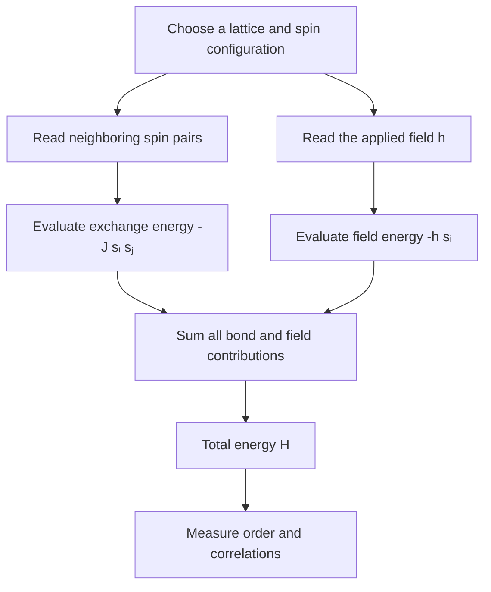
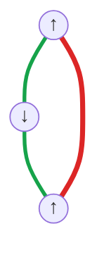
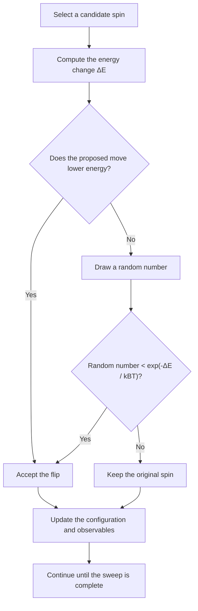
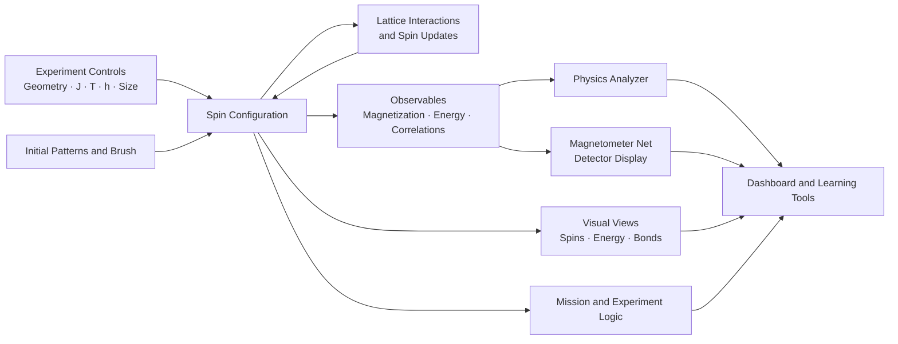

# spin-flip-the-quantum-lab-ising-model-simulator
https://spin-flip-the-quantum-lab-ising-mod.vercel.app

.png?raw=true)
.png?raw=true)
.png?raw=true)


# Spin Flip — The Quantum Lab: Ising Model Simulator

An interactive lattice-spin laboratory for exploring magnetic ordering, thermal disorder, external fields, and geometric frustration with the Ising model.

<p align="center">
  <a href="https://spin-flip-the-quantum-lab-ising-mod.vercel.app/">
    <strong>🚀 Launch the Live Simulator</strong>
  </a>
</p>

Spin Flip lets you prepare spin configurations, change the lattice geometry and interaction type, vary temperature and magnetic field, and watch the resulting patterns and measurements evolve. Guided missions turn the experiment into a sequence of physics challenges, while the Physics Analyzer and Magnetometer Net provide additional ways to interpret a configuration.

> **Physics note — Classical versus quantum:** Despite the “Quantum Lab” branding, the controls and observables exposed by the published application correspond to a classical Ising-style lattice simulation: each site is represented by an up/down spin. This is not, by itself, a quantum Ising solver. A quantum Ising model would require additional ingredients such as a transverse-field operator and a quantum state or quantum many-body solver.

---

## Table of Contents

- [Explore the Simulator](#explore-the-simulator)
- [The Physics: The Ising Model](#the-physics-the-ising-model)
- [Lattice Geometry and Frustration](#lattice-geometry-and-frustration)
- [Temperature, Fields, and Spin Flips](#temperature-fields-and-spin-flips)
- [Measurements and What They Mean](#measurements-and-what-they-mean)
- [Reading the Phase Behavior](#reading-the-phase-behavior)
- [Conceptual Architecture](#conceptual-architecture)
- [Suggested Experiments](#suggested-experiments)
- [Running the Project Locally](#running-the-project-locally)
- [Scientific Scope and Limitations](#scientific-scope-and-limitations)
- [References](#references)

---

## Explore the Simulator

**Live application:** https://spin-flip-the-quantum-lab-ising-mod.vercel.app/

The published interface exposes the following experiment tools:

| Area | Controls / Displays | What to Explore |
|---|---|---|
| Lattice | Square and Triangle | Compare a bipartite square lattice with a triangular lattice that can be geometrically frustrated. |
| Interaction | Ferro and Anti | Switch between interactions that favor aligned and anti-aligned neighboring spins. |
| Thermodynamic Controls | Temperature `T` and magnetic field `h` | Tune thermal disorder and the preference for up or down spins. |
| Simulation | Sweeps per frame | Change how quickly the configuration evolves on screen. |
| Sample Size | `16²`, `24²`, `32²`, `48²` | Compare smaller and larger finite lattices. |
| Initial Configurations | Random, All up, Checkerboard, Two domains, Stripes | Start from distinct spin textures and examine their relaxation. |
| Editing | Brush with Flip Up / Down | Manually change local spins and create defects or domains. |
| Visualization | Spins, Energy, Bonds | View the configuration through different representations. |
| Measurements | Magnetization, staggered magnetization, energy/site, neighbor correlation, unhappy bonds, pattern entropy | Quantify order, energetic favorability, local alignment, and pattern complexity. |
| Learning Tools | Missions, AI Battle, Explain, Phase Hunter, Notebook, Materials, Leaderboard, Archive | Explore the guided learning and analysis features exposed by the application. |

The interface also shows a **Physics Analyzer** phase label and an **AI detector** labelled *Magnetometer Net v1*. Their outputs are useful aids for exploration; they should be interpreted separately from the exact thermodynamic observables defined below.

### Guided Missions

The published interface lists seven missions. Their names indicate the central concept each challenge is intended to teach:

| Mission | Topic | Physics Idea |
|---|---|---|
| Create a Magnet | Magnetism | Build a state with strong net magnetization. |
| The Checkerboard | Magnetism | Explore staggered order on a bipartite lattice. |
| Polarize a Paramagnet | Magnetism | Use an external field to bias a thermally disordered sample. |
| The Impossible Triangle | Frustration | Discover why an antiferromagnetic triangle cannot satisfy all three bonds. |
| Find the Critical Temperature | Criticality | Explore the loss of long-range order as temperature changes. |
| Fool the Detector | Machine Learning | Test how a detector responds to patterns that may confuse its phase label. |
| Train a Better Detector | Machine Learning | Explore the detector-training challenge exposed by the app. |

The application shows mission progress and a score. Exact scoring rules and detector-training procedures are implementation-specific and are not inferred here.

---

# The Physics: The Ising Model

The Ising model is one of the simplest models of collective magnetism. It represents a material as a set of sites on a lattice. Each site carries a spin variable that can point in one of two directions:

\[
s_i \in \{-1,+1\}.
\]

Here:

- `+1` represents an up spin.
- `−1` represents a down spin.

A spin interacts with its neighboring sites. Although an individual spin has only two possible values, the interactions allow a large system to develop collective behavior: a magnet can form, domains can grow, and thermal fluctuations can destroy long-range order.

## 1. Hamiltonian: The Energy of a Configuration

A standard nearest-neighbor Ising Hamiltonian in an external magnetic field is:

\[
\boxed{
\mathcal{H}(\{s_i\}) =
-J\sum_{\langle i,j\rangle}s_i s_j
-h\sum_i s_i
}
\]

Where:

- `⟨i,j⟩` denotes a pair of neighboring lattice sites. Each bond is counted once.
- `J` is the exchange coupling between neighboring spins.
- `h` is the applied magnetic field.
- `𝓗` is the total energy of a spin configuration.

The sign of `J` determines what neighboring spins prefer to do:

| Interaction | Sign Convention | Lowest-Energy Bond | Typical Ordered Pattern |
|---|---|---|---|
| Ferromagnetic | `J > 0` | Parallel: ↑ ↑ or ↓ ↓ | Uniform alignment |
| Antiferromagnetic | `J < 0` | Anti-parallel: ↑ ↓ or ↓ ↑ | Alternating order on a bipartite lattice |

The overall minus sign in the Hamiltonian is important.

For `J > 0`, a bond has lower energy when:

\[
s_i s_j = +1
\]

For `J < 0`, a bond has lower energy when:

\[
s_i s_j = -1
\]

## 2. How Local Interactions Create Collective Order

The energy is built by adding contributions from every neighboring pair and every spin's interaction with the external field.

A single spin therefore feels an effective local environment formed by its neighbors and by `h`.



For an isolated spin `sᵢ`, flipping it to `−sᵢ` changes the energy by:

\[
\boxed{
\Delta E_i =
2s_i
\left(
J\sum_{j\in nn(i)}s_j+h
\right)
}
\]

Where `nn(i)` is the set of nearest neighbors of site `i`.

This expression explains why a spin surrounded by aligned neighbors is energetically costly to reverse in a ferromagnet, while the opposite tendency holds for an antiferromagnet.

---

# Lattice Geometry and Frustration

The lattice determines which sites count as neighbors. That geometry can matter as much as the interaction strength.

## 1. Square Lattice: Two Sublattices

A square lattice is **bipartite**.

Its sites can be divided into two groups, A and B, so every nearest-neighbor bond connects A to B.

This makes antiferromagnetic order possible without conflict.

One sublattice points up and the other points down, forming a checkerboard pattern.

### Square-Lattice Antiferromagnetic Pattern

```text
    A   B   A   B
    B   A   B   A
    A   B   A   B
    B   A   B   A

    A = ↑
    B = ↓
```

Every neighboring pair is anti-aligned.

### Square-Lattice Ferromagnetic Pattern

```text
    ↑   ↑   ↑   ↑
    ↑   ↑   ↑   ↑
    ↑   ↑   ↑   ↑
    ↑   ↑   ↑   ↑
```

All neighboring spins are aligned.

In the ferromagnetic case, the system minimizes its exchange energy by developing a uniform spin configuration.

## 2. Triangular Lattice: Geometric Frustration

The triangular lattice introduces something fundamentally different.

Consider three sites forming an elementary triangle.

In an antiferromagnet, each bond prefers its two spins to be opposite.

However, three spins cannot make all three pairs opposite simultaneously.

At least one bond on every triangle must be unsatisfied.



In this example:

- The first bond is satisfied.
- The second bond is satisfied.
- The third bond is frustrated.

The system cannot satisfy all three antiferromagnetic interactions at once.

This is known as **geometric frustration**.

Geometric frustration produces many possible low-energy spin configurations because the system has multiple ways to distribute its unsatisfied bonds.

### Why This Matters

| Lattice | Interaction | Expected Behavior |
|---|---|---|
| Square | Ferromagnetic | Uniform alignment |
| Square | Antiferromagnetic | Checkerboard order |
| Triangle | Ferromagnetic | Uniform alignment |
| Triangle | Antiferromagnetic | Frustrated magnetic configurations |

The distinction is especially important:

**Square + Antiferromagnetic**

A checkerboard arrangement can satisfy every nearest-neighbor bond, subject to compatible boundary conditions.

**Triangle + Antiferromagnetic**

Every elementary triangle contains at least one unsatisfied bond. A simple checkerboard is not a valid description of the ground-state physics.

**Ferromagnetic Interactions**

Uniform alignment satisfies all nearest-neighbor bonds on either geometry.

The triangular antiferromagnetic Ising model is a classic example of a frustrated system with an extensively degenerate ground-state manifold and residual entropy.

It is especially useful for seeing why lower temperature does not always produce one perfectly ordered pattern.

---

# Temperature, Fields, and Spin Flips

## 1. Temperature Controls Thermal Fluctuations

At nonzero temperature, the system does not simply choose the single lowest-energy configuration.

Instead, configurations are sampled according to their Boltzmann weight:

\[
\boxed{
P(\{s_i\}) =
\frac{1}{Z}
\exp\left[
-\frac{\mathcal{H}(\{s_i\})}{k_B T}
\right]
}
\]

Where:

\[
Z =
\sum_{\{s_i\}}
\exp\left[
-\frac{\mathcal{H}(\{s_i\})}{k_B T}
\right]
\]

Here:

- `T` is temperature.
- `kB` is Boltzmann's constant.
- `Z` is the partition function.
- `𝓗` is the configuration energy.

The ratio between energy and thermal scale determines how strongly energetic preferences influence the system.

### Low Temperature

Energetic preferences dominate.

Ordered configurations are favored when the lattice geometry allows them.

### High Temperature

Thermal fluctuations become strong.

Spins frequently change direction, and long-range magnetic order is generally weakened or destroyed.

### Near a Critical Temperature

Correlations can extend across many lattice spacings.

The system can fluctuate strongly between local patterns, and collective behavior becomes particularly interesting.

In many numerical demonstrations, units are chosen so that:

\[
k_B = 1
\]

and sometimes:

\[
|J| = 1.
\]

The app's control values should be treated as simulation parameters unless its source explicitly documents the physical unit convention.

## 2. External Magnetic Field

The field contribution is:

\[
E_{\text{field}} = -h\sum_i s_i
\]

The magnetic field changes the energy preference of the spins.

| Field | Physical Effect |
|---|---|
| `h > 0` | Favors up spins |
| `h < 0` | Favors down spins |
| `h = 0` | No global preference between up and down from the field term alone |

A sufficiently strong field can polarize the lattice even when temperature would otherwise make the spins disordered.

This makes the field control a useful way to separate interaction-driven ordering from field-driven alignment.

## 3. Monte Carlo Spin Flips

A Monte Carlo simulation evolves a lattice by proposing changes to the configuration and accepting or rejecting them according to a sampling rule.

A common single-spin method is the Metropolis algorithm.

For that algorithm, a proposed flip with energy change `ΔE` is accepted with probability:

\[
\boxed{
P_{\text{accept}} =
\min\left(
1,
e^{-\Delta E/(k_B T)}
\right)
}
\]

This means:

- If `ΔE ≤ 0`, the move is accepted.
- If `ΔE > 0`, the move may still be accepted depending on temperature.

Downhill moves are accepted.

Uphill moves can still occur at finite temperature.

Those occasional uphill moves are essential because they allow the system to escape local minima and reproduce thermal fluctuations.

### The Spin-Flip Process



*The diagram shows the standard Metropolis reference algorithm, not a verified source-code flowchart for this particular application.*

### What Is a Monte Carlo Sweep?

A Monte Carlo sweep is conventionally a number of attempted updates proportional to the number of lattice sites, often one attempted update per site on average.

The interface exposes a sweeps-per-frame speed control.

The exact site-selection strategy, acceptance rule, boundary conditions, and definition of a sweep are implementation details. Consult the simulator source before treating this generic Metropolis description as a claim about its precise update algorithm.

---

# Measurements and What They Mean

The Measurements panel exposes several quantities that turn a visual pattern into something you can compare across experiments.

## 1. Magnetization

The signed magnetization per spin is:

\[
\boxed{
m = \frac{1}{N}\sum_{i=1}^{N}s_i
}
\]

It ranges from:

\[
-1 \leq m \leq +1
\]

Interpretation:

- `m = +1`: All spins point up.
- `m = −1`: All spins point down.
- `m ≈ 0`: Little net polarization.

A value near zero can indicate a disordered state, but it can also occur when large up and down domains cancel.

The interface displays **absolute magnetization**:

\[
|m|
\]

This reports the strength of net polarization without distinguishing up from down.

## 2. Staggered Magnetization

For a square bipartite lattice, assign a sign `εᵢ = +1` to one sublattice and `−1` to the other.

Then:

\[
\boxed{
m_s =
\frac{1}{N}
\sum_i \epsilon_i s_i
}
\]

A checkerboard antiferromagnet has a large `|mₛ|` even though its ordinary net magnetization is close to zero.

This is why both `|m|` and `|mₛ|` matter.

They detect different kinds of magnetic order.

A checkerboard staggered order parameter is naturally defined on a bipartite lattice; on the triangular lattice it should not be interpreted as a universal detector of antiferromagnetic order.

## 3. Energy Per Site

\[
\boxed{
e = \frac{\mathcal{H}}{N}
}
\]

Energy per site allows configurations of different sizes to be compared.

For a fixed geometry and parameter set, lower energy indicates a configuration that better satisfies the interaction and field preferences.

The value depends on the coupling convention, field, and bond-counting convention used by the program.

## 4. Nearest-Neighbor Correlation

A common definition is:

\[
\boxed{
C_1 =
\frac{1}{N_b}
\sum_{\langle i,j\rangle}
s_i s_j
}
\]

Where `N_b` is the number of bonds.

Interpretation:

- Positive correlation: Predominantly parallel neighboring spins.
- Negative correlation: Predominantly anti-parallel neighboring spins.
- Near-zero correlation: Weak average nearest-neighbor alignment.

The sign alone does not identify the full phase. Geometry and interaction sign must also be considered.

## 5. Unhappy-Bond Fraction

A bond is happy when it satisfies the preferred local interaction, and unhappy when it does not.

With the Hamiltonian convention above, an unsatisfied bond has:

\[
J s_i s_j < 0
\]

A useful definition is:

\[
\boxed{
f_{\text{unhappy}} =
\frac{1}{N_b}
\sum_{\langle i,j\rangle}
\mathbf{1}[J s_i s_j < 0]
}
\]

Where `1[condition]` is 1 when the condition is true and 0 otherwise.

On a triangular antiferromagnet, an unhappy-bond fraction above zero is not necessarily a sign of poor equilibration.

Frustration makes some unsatisfied bonds unavoidable.

## 6. Pattern Entropy

The interface also reports **Pattern entropy**.

This is not a standard name for a unique Ising thermodynamic observable.

Unless the code documents its precise calculation, treat it as an application-specific measure of pattern diversity or complexity, not as the thermodynamic entropy:

\[
S = k_B \ln \Omega
\]

or the full Gibbs entropy.

A highly mixed-looking image can have high visual pattern complexity without proving that the system is in a thermodynamic phase.

### Measurement Summary

| Measurement | Main Question | Important Caveat |
|---|---|---|
| `|m|` | Is there net up/down polarization? | Opposite domains can cancel in signed `m`. |
| `|mₛ|` | Is there checkerboard-like staggered order? | Most directly meaningful on a bipartite lattice. |
| Energy / site | How energetically favorable is the configuration? | Compare at the same parameters and conventions. |
| `⟨sᵢsⱼ⟩` | Do neighbors tend to align or anti-align? | Depends on lattice and interaction sign. |
| Unhappy bonds | How many bonds violate their local preference? | Frustrated lattices can require unhappy bonds. |
| Pattern entropy | How visually or statistically varied is the pattern? | Application-specific until its exact formula is documented. |

---

# Reading the Phase Behavior

The Physics Analyzer displays a phase label, and the detector reports category scores.

These are useful for navigating the experiment, but a finite lattice does not exhibit a mathematically sharp thermodynamic singularity in the same way as an infinite system.

Near a phase transition, finite-size effects and statistical fluctuations can blur the classification.

## Critical Temperature

For context, the exact zero-field critical temperature of the infinite, nearest-neighbor, isotropic square-lattice ferromagnetic Ising model is:

\[
\boxed{
\frac{k_B T_c}{J}
=
\frac{2}{\ln(1+\sqrt{2})}
\approx 2.269185
}
\]

For the corresponding triangular-lattice ferromagnet:

\[
\boxed{
\frac{k_B T_c}{J}
=
\frac{4}{\ln 3}
\approx 3.640957
}
\]

These values are benchmarks for specific ideal models, not guaranteed thresholds for the app's finite samples.

They assume:

- Zero external magnetic field.
- Uniform nearest-neighbor coupling.
- The usual Hamiltonian convention with `J > 0`.
- An infinite lattice.

Boundary conditions, finite size, nonzero field, and the implementation's update and measurement choices affect what the UI shows.

## Recognizing Magnetic Phases

### Ferromagnetic Ordering

Typical characteristics:

- Large coherent up or down regions.
- Increasing absolute magnetization.
- Increasingly satisfied neighboring bonds as temperature falls.
- Strong positive nearest-neighbor correlations.

### Antiferromagnetic Ordering

Typical characteristics on the square lattice:

- Checkerboard patterns.
- Alternating up and down spins.
- Near-zero net magnetization.
- Large staggered magnetization.
- Predominantly anti-aligned neighboring spins.

### Paramagnetic-Like Disorder

Typical characteristics:

- Short-lived local clusters.
- Weak long-range correlations.
- Small global order parameters in a sufficiently large unbiased sample.
- Strong thermal fluctuations.

### Frustrated Magnetic States

Typical characteristics on the triangular antiferromagnet:

- Local anti-alignment tendencies.
- Unavoidable unsatisfied bonds.
- Multiple low-energy arrangements.
- No simple checkerboard description.

**Important:** A detector confidence such as “Paramagnetic 87%” is a model output, not an 87% probability that the thermodynamic system is in a rigorously defined phase.

For careful scientific work, compare observables across repeated runs and multiple lattice sizes rather than relying on one label.

---

# Conceptual Architecture

The repository's public page documents the user-facing controls and measurements.

The following diagram is a **conceptual data flow** for the application, not a claim about the exact names or boundaries of internal source-code modules.



### Main Scientific Loop

1. Select a lattice, interaction type, temperature, and field.
2. Choose or edit an initial spin configuration.
3. Evolve the configuration using the simulator's update mechanism.
4. Recompute or sample the measurements.
5. Compare the resulting pattern and observables with the physical expectations for that model.

---

# Suggested Experiments

These experiments map directly to the controls and missions visible in the application.

## Experiment 1: Create a Ferromagnet

**Objective:** Observe spontaneous magnetic ordering.

Steps:

1. Select **Square** and **Ferro**.
2. Initialize the lattice with **Random**.
3. Set a low temperature and run the simulation.
4. Watch whether aligned domains grow and whether `|m|` increases.
5. Repeat at a higher temperature and compare the resulting patterns.

**Questions:**

- How does temperature affect magnetic ordering?
- Why do neighboring spins tend to align in a ferromagnet?
- What happens when thermal fluctuations become stronger?

## Experiment 2: Build a Checkerboard Antiferromagnet

**Objective:** Understand staggered magnetic order.

Steps:

1. Select **Square** and **Anti**.
2. Initialize with **Checkerboard**.
3. Observe `|m|` and `|mₛ|` together.
4. Compare with an all-up initial state.

**Questions:**

- Why can a system have nearly zero net magnetization and still be strongly ordered?
- Why is a checkerboard arrangement energetically favorable?
- What makes the square lattice suitable for antiferromagnetic ordering?

## Experiment 3: Polarize a Paramagnet with a Field

**Objective:** Understand the influence of an external magnetic field.

Steps:

1. Choose a relatively high temperature.
2. Set the field to zero and observe the global magnetization.
3. Increase `h` in the positive direction.
4. Observe how spins respond.
5. Reverse the field and repeat.

**Questions:**

- Can an external field create a net polarization even when thermal fluctuations remain strong?
- How does the system respond to reversing the field?
- What happens when the field competes with neighboring-spin interactions?

## Experiment 4: Investigate Triangular Frustration

**Objective:** Explore geometric frustration.

Steps:

1. Select **Triangle** and **Anti**.
2. Start from **Random** or another initial pattern.
3. Lower the temperature and inspect the bonds view.
4. Look for residual unsatisfied bonds on triangular plaquettes.

**Questions:**

- Why cannot every edge of one triangle be anti-aligned at the same time?
- Why do frustrated systems have multiple low-energy configurations?
- Why can some unhappy bonds remain even at low temperature?

## Experiment 5: Explore Finite-Size Effects Near Criticality

**Objective:** Understand phase transitions in finite systems.

Steps:

1. Choose a ferromagnetic lattice at zero field.
2. Start with a disordered configuration.
3. Change the sample size from `16²` through `48²`.
4. Repeat temperature scans for each size.
5. Compare the apparent onset of order and fluctuations in the measured quantities.

**Questions:**

- Why does a small sample give a less precise picture of a phase transition?
- How does system size affect fluctuations?
- Why do larger systems provide better information about collective behavior?

## Experiment 6: Compare Initial Conditions

**Objective:** Understand relaxation and metastability.

Use:

- All up.
- Checkerboard.
- Two domains.
- Stripes.
- Random.

Run each initial configuration with the same model parameters.

Compare the relaxation pathways and ask whether different starts converge to similar long-time statistics.

A single final image is not enough to establish equilibrium. Repeated runs and adequate sampling matter.

---

# Running the Project Locally

The public GitHub repository currently exposes the application bundle as `project.zip` and links to the deployed simulator.

Its browsable root does not document a package manager, framework version, or development script, so the commands below deliberately avoid assuming a particular build stack.

## 1. Clone the Repository

```bash
git clone https://github.com/lucylow/spin-flip-the-quantum-lab-ising-model-simulator.git

cd spin-flip-the-quantum-lab-ising-model-simulator
```

## 2. Extract the Published Project Bundle

```bash
unzip project.zip -d extracted-project
```

## 3. Inspect the Project Files

```bash
find extracted-project -maxdepth 3 -type f | sort | head -200
```

Find the available project manifests:

```bash
find extracted-project \
  -name package.json \
  -o -name pyproject.toml \
  -o -name requirements.txt
```

Then follow the manifest and lockfile included in the extracted project.

- For a Node.js project, use the package manager indicated by its lockfile and inspect available scripts with `npm run` or the equivalent package-manager command.
- Run the development command only if it is actually defined in the project's manifest.
- For a Python project, follow the included `pyproject.toml` or `requirements.txt` rather than guessing dependencies.

### Live Deployment

The deployed application is available at:

https://spin-flip-the-quantum-lab-ising-mod.vercel.app/

---

# Scientific Scope and Limitations

This project is best understood as an **interactive educational simulator** for visual intuition and qualitative experiments.

Keep the following distinctions in mind when interpreting results or extending the project.

### 1. Classical Spins Are Not Quantum States

A classical Ising variable:

\[
s_i = \pm 1
\]

is not a spinor or a full quantum spin operator.

A quantum transverse-field Ising model typically includes a term such as:

\[
-\Gamma\sum_i \sigma_i^x
\]

in addition to the longitudinal interaction terms and requires a quantum treatment.

### 2. A Finite Lattice Is Not the Thermodynamic Limit

Critical behavior is rounded by finite-size effects.

Reliable estimates of critical exponents or critical temperatures require systematic size scaling and statistical analysis.

### 3. Equilibration and Sampling Matter

Results can depend on:

- Initial conditions.
- Run length.
- Update algorithm.
- Random seed.
- Lattice size.

Run multiple independent trials when making comparisons.

### 4. Frustration Changes the Meaning of Unhappy

On a triangular antiferromagnet, some unsatisfied bonds are required by geometry, even in a ground state.

### 5. Classifier Labels Are Not Measurements

The Physics Analyzer and Magnetometer Net are additional interpretation tools.

Their definitions, training data, and confidence calibration should be documented separately before using them for scientific inference.

### 6. Some Displayed Quantities Are Application-Specific

In particular, document the exact formula for Pattern entropy and the precise definition of the sweep/update procedure in the source before treating them as standardized physical quantities.

---

# References

The physics behind the simulator is based on established results in statistical mechanics and condensed matter physics.

### 1. The Two-Dimensional Ising Model

L. Onsager,

"Crystal Statistics. I. A Two-Dimensional Model with an Order-Disorder Transition."

*Physical Review*, 65, 117–149 (1944).

https://doi.org/10.1103/PhysRev.65.117

### 2. The Metropolis Algorithm

N. Metropolis, A. W. Rosenbluth, M. N. Rosenbluth, A. H. Teller, and E. Teller,

"Equation of State Calculations by Fast Computing Machines."

*The Journal of Chemical Physics*, 21, 1087–1092 (1953).

https://doi.org/10.1063/1.1699114

### 3. Triangular Ising Antiferromagnetism

G. H. Wannier,

"Antiferromagnetism. The Triangular Ising Net."

*Physical Review*, 79, 357 (1950).

https://doi.org/10.1103/PhysRev.79.357

### 4. Critical Couplings

For a concise numerical reference to exact critical couplings on common lattices:

https://numberdb.org/Critical_couplings_of_the_Ising_model_on_lattices

---

# Contributing and Extending the Documentation

When documenting or changing the simulation engine, please make the following implementation details explicit:

- Boundary conditions (periodic, open, or other).
- Exact neighbor list and bond-counting convention for each lattice.
- Whether the update is Metropolis, heat-bath, Glauber, cluster-based, or another method.
- The number and selection order of proposed spin updates in one sweep.
- Random-number generator and seed behavior.
- Exact definitions of each reported measurement, especially Pattern entropy and detector scores.
- How the phase analyzer maps observables to phase labels.

These details make simulations reproducible and help readers distinguish the universal physics of the Ising model from choices made by a particular implementation.

---

<p align="center">
  <strong>Spin Flip — The Quantum Lab</strong>
  <br>
  Exploring magnetism, statistical mechanics, and emergent behavior one spin at a time.
  <br><br>
  <a href="https://spin-flip-the-quantum-lab-ising-mod.vercel.app/">
    Launch the Simulator
  </a>
</p>
